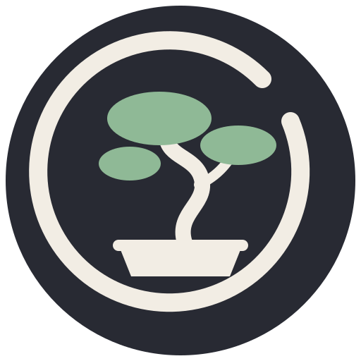

<!--
   - This Source Code Form is subject to the terms of the Mozilla Public
   - License, v. 2.0. If a copy of the MPL was not distributed with this
   - file, You can obtain one at http://mozilla.org/MPL/2.0/.
   -->


### Zen Bonsai

An unofficial fork of [Zen Browser](https://github.com/zen-browser/desktop)
with native tree-style tabs.

[](https://crowdin.com/project/zen-browser)

Tree-style tabs built into the browser rather than layered on with userChrome
CSS or an extension. Tabs nest under a parent, collapse, and keep their shape
across a restart. Everything else is stock Zen, tracking upstream `dev`.

---

> [!WARNING]
>  ### Disclaimer
>
>  This fork is provided "as is", without warranty of any kind. It it "works on my machine", but no guarantees! Use at your own risk. The author(s) accept no liability for any damage, data loss, or other issues arising from its use.
>
> That said, I hope you enjoy! Please post an issue if you have any problems with tree-style-tabs.

> [!IMPORTANT]
> ### Unofficial fork
>
> Zen Bonsai is a fork of [zen-browser/desktop](https://github.com/zen-browser/desktop),
> not affiliated with or endorsed by the Zen team. Zen Browser is the Zen team's
> work; this fork adds to it, under the same MPL-2.0 license.
>
> It keeps upstream's application id, binary name (`zen`) and profile
> directory, and changes only the displayed name and icon, so it is a drop-in
> replacement and shares the same profile directory as stock Zen. Two
> consequences:
>
> - You cannot install both from a package manager; they own the same paths.
> - Opening the same profile in stock Zen works, but stock Zen ignores the
>   `zen-tree-*` attributes this fork stores, so a round trip through it
>   flattens the tab tree. Back up your profile before switching back and
>   forth.

---

### What this fork adds

#### Tree-style tabs

Tabs carry a parent, so opening a link from a tab nests it underneath instead
of appending it to a flat list. A twisty appears on any tab with children and
collapses the subtree. The structure is written into the session as
`zen-tree-id` and `zen-tree-parent-id`, so it survives a restart rather than
being rebuilt from heuristics. Middle-drag selects and closes across a subtree.
Lives in `src/zen/tab-tree`, with mochitests in `src/zen/tests/tab-tree`.

#### Managed Spaces

`src/zen/space-routing/ZenManagedSpaces.sys.mjs` lets Spaces and their
container assignments be declared from an enterprise policy file rather than
clicked in by hand, which is what makes the browser configurable from a Nix
module.

#### Container routing on Space move

Moving a tab into a Space adopts that Space's container.

#### Space switching on drag, off by default

Upstream switches Space when you hold a dragged tab against the left or right
edge of the tab strip. Those edges are also where a tree drag reorders a tab
without nesting it, and a mouse with back/forward buttons already switches
Space, so the gesture fires when you did not ask for it. This fork ships it
disabled. Set `zen.workspaces.dnd-switch-enabled` to `true` in `about:config`
to get upstream's behaviour back; `zen.workspaces.dnd-switch-padding` (edge
width in px) and `zen.tabs.dnd-switch-space-delay` (hold in ms) still tune it.
Dragging a tab onto a Space icon switches Space either way.

#### A Nix flake

Builds Zen from source with `buildMozillaMach`, described below.

### Installing

Releases are tagged `<upstream-tag>-bonsai.<n>`, so `1.23.2b-bonsai.1` is the first
fork build on top of upstream's `1.23.2b`. Earlier releases used a `-tst.<n>`
suffix and the package name `zen-browser-tst`.

- Tarball, deb and rpm are attached to each
  [release](https://github.com/joegoldin/zen-bonsai-browser/releases). The deb
  and rpm install to `/opt/zen-bonsai` with a `/usr/bin/zen` symlink, and both
  declare `conflicts`/`provides` against `zen-browser`. They also replace the
  pre-rename `zen-browser-tst` package, so installing one upgrades it in place.
- On Arch, install
  [`zen-bonsai-browser-bin`](https://aur.archlinux.org/packages/zen-bonsai-browser-bin)
  from the AUR. The release workflow keeps it in step with each release;
  `packaging/aur/` here is its source.
- On Nix, see below.

### Nix

The flake builds Zen from source with `buildMozillaMach`, patching a pristine
Firefox tarball with this fork's patchset. Nothing prebuilt is fetched, so the
binary you run is one you compiled from a source tree you can read.

```bash
nix build github:joegoldin/zen-bonsai-browser#zen-bonsai-browser-unwrapped
```

`zen-bonsai-browser-unwrapped` (also exported under its old name,
`zen-browser-unwrapped`) is an unwrapped Firefox-style derivation, which is the
shape every Firefox wrapper in nixpkgs and home-manager expects. Wrap it
yourself if all you want is the browser:

```nix
{
  inputs.zen-src.url = "github:joegoldin/zen-bonsai-browser/dev";
}

# then, in a module:
home.packages = [ (pkgs.wrapFirefox inputs.zen-src.packages.${pkgs.system}.zen-bonsai-browser-unwrapped { }) ];
```

#### With home-manager

[`0xc000022070/zen-browser-flake`](https://github.com/0xc000022070/zen-browser-flake)
has a home-manager module covering the parts of Zen that plain `programs.firefox`
knows nothing about: Spaces, pinned tabs, space routing, keyboard shortcuts,
mods and theme presets. It normally installs Zen's official prebuilt binary,
but its `unwrappedPackage` option takes any unwrapped Firefox-style derivation,
so it will drive this fork's source build instead:

```nix
{
  imports = [ inputs.zen-browser-flake.homeModules.default ];

  programs.zen-browser = {
    enable = true;
    # The browser you compiled, rather than the prebuilt tarball the flake
    # would otherwise fetch from upstream's releases.
    unwrappedPackage = inputs.zen-src.packages.${pkgs.system}.zen-bonsai-browser-unwrapped;
    # The default is derived from that flake's own variant names, none of
    # which this is.
    icon = "zen-browser";
  };
}
```

All of that module works against this package, sine mods included. Sine needed
help: it installs its bootloader by globbing `lib/zen-bin-*`, which is how that
flake's repacked tarball is laid out and not how a `mach` build is, so
`nix/package.nix` links that name to the real application directory. It finds
that directory rather than assuming it, because `buildMozillaMach` has renamed
it before.

`nix/zen-browser.nix` reads the Firefox version out of `surfer.json` so the
fetched source always matches the base the patches target. The source hash next
to it is pinned by hand and has to move with it.

`flake.nix` keeps a second, newer nixpkgs only for the macOS `apple-sdk_26`,
which `nixos-26.05` will not catch up on: 26.05 branched before nixpkgs bumped
it to 26.5 and never took the backport, so it stays at 26.4 for the life of the
release. Everything Linux builds against, NSS and cbindgen included, comes from
`nixos-26.05` itself. An NSS from the newer pin (built with gcc 16) once broke
the PGO profile run: it fails to load its soft token in Firefox's sandboxed
socket process, which then exits during startup.

`devenv.nix` provides the development shell that `mach` and `npm run lint`
need. Two details in it are load-bearing: jemalloc is filtered off
`LD_LIBRARY_PATH`, because it breaks the `uv` that mach uses to build its
virtualenvs, and `zstandard` is added to the devenv python, because mach needs
it to extract toolchain archives.

### Tracking upstream

`merge-upstream-zen.yml` runs when you dispatch it. It merges `upstream/dev` on
a scratch branch and opens a PR; it never pushes to `dev` and never resets it.
A conflict is expected on Firefox bumps and is not treated as an error. The
markers are committed and the PR says so.

Conflicts concentrate in four `.patch` files plus `surfer.json`, because a
Firefox bump shifts the line numbers every hunk header refers to. The
resolution procedure, the regression gate, and the measured test baselines are
in [docs/fork-maintenance.md](./docs/fork-maintenance.md).

### Contributing

Bugs and feature requests for the fork's own behaviour go to
[this repo's issues](https://github.com/joegoldin/zen-bonsai-browser/issues).
Anything that reproduces on stock Zen belongs
[upstream](https://github.com/zen-browser/desktop/issues) instead.

Upstream's [contribution guidelines](./docs/contribute.md) still apply to the
shared code.
